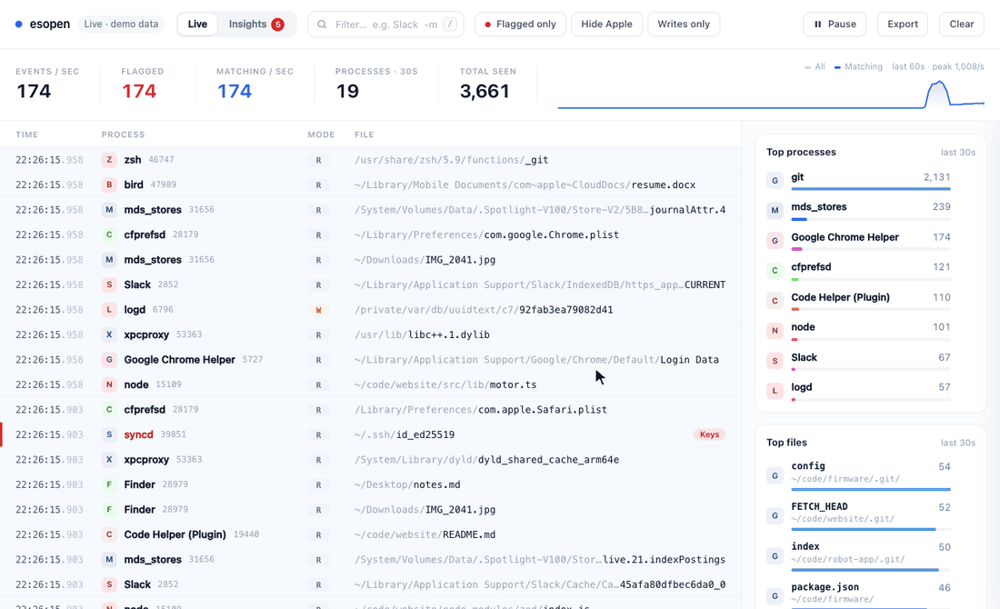

# esopen

**See every file your Mac opens, live, and find out which apps are touching your private data.**



esopen is a single Python file that turns Apple's built-in Endpoint Security logger (`eslogger`) into a live, searchable view in your browser. Its **Insights** tab flags apps that go near sensitive things: your messages and mail, browser passwords and cookies, SSH keys, startup files and more.

## Install

Paste this into Claude Code, Codex, Cursor, ChatGPT or any AI assistant:

```
Install and start esopen on my Mac by following https://raw.githubusercontent.com/sincethestudy/esopen/main/AGENT_INSTALL.md
```

The agent handles everything except two things only you can do: typing your Mac password, and turning on one switch in System Settings.

## What you get

**Live** shows every file open as it happens: time, process, read or write, and path.

- Type to filter. Use `-word` to exclude, or `proc:"Code Helper"`, `path:~/Documents`, `pid:123` to target a field.
- **Writes only** and **Hide Apple** cut out most of the system noise.
- Click a row for the full path, access flags, executable, signing ID, team ID and parent process.
- The side panel shows the busiest processes and files from the last 30 seconds.
- `Space` pauses, `/` jumps to search, **Export** downloads the list as CSV.

**Insights** keeps a running summary of everything since esopen started:

- **Findings**, ranked High, Medium and Low:
  - a non-Apple app opening your Messages, Mail, Contacts, Notes or the privacy-permissions database
  - an app opening another app's saved passwords, cookies or browsing history
  - access to crypto wallets (MetaMask, Coinbase Wallet, Phantom, Exodus, Electrum…)
  - access to SSH keys, cloud credentials, `.env` files or your Photos library
  - apps reading other apps' private folders
  - programs running from hidden or temporary folders, or without a developer signature
  - anything changing startup files (LaunchAgents, LaunchDaemons, shell profiles)
- **Who signed each program**, for example "Meta Platforms, Inc.", so you know who's behind it.
- **Sensitive places**, showing which apps touched each one.

## Reading the results

- Apps opening their own data, like Chrome opening Chrome's cookies, aren't flagged.
- macOS also reports attempts it blocked. An entry means an app *tried* to open a file, not necessarily that it succeeded.
- Leave it running while you use your Mac normally. Some apps only act every few minutes or hours.
- File activity can't show screen recording, keystroke monitoring or network traffic. Review those in System Settings → Privacy & Security.
- If an app worries you, remove it from Full Disk Access, uninstall it, and check `~/Library/LaunchAgents` for anything it left behind.

## Privacy and safety

- **Nothing leaves your Mac.** The viewer is only served on `127.0.0.1`, and it rejects requests that come from other websites.
- **Nothing is saved to disk.** Events stay in memory (the browser keeps the latest 50,000) and are gone when you stop esopen.
- **It only watches.** It runs `eslogger` as root because macOS requires that, but it never blocks or changes anything.
- **It's one readable file** using only Python's standard library. Read it before you run it.

## Options

```
python3 esopen.py [--demo] [--port PORT] [--no-open]
```

| Option | What it does |
|---|---|
| `--demo` | Fake data, no password needed |
| `--port PORT` | Port for the local page (default 4747; uses the next free one if it's taken) |
| `--no-open` | Don't open the browser automatically |

## Troubleshooting

| Message | Fix |
|---|---|
| "macOS blocked it: *App* needs Full Disk Access" | Turn on Full Disk Access for that app (esopen opens the setting for you), quit and reopen it, then run esopen again. |
| "needs macOS 13 (Ventura) or newer" | `eslogger` only exists on macOS 13+. |
| "too many Endpoint Security clients" | Another `eslogger` or esopen is already running. Stop it first. |
| A **Dropped** counter appears | Events arrived faster than macOS could deliver them. A few is normal. |

## Uninstall

Stop it with `Ctrl+C`, then run `rm -rf ~/.esopen`. Optionally turn off your terminal's Full Disk Access.

## How it works

macOS 13 added `/usr/bin/eslogger`, a command-line client for Apple's Endpoint Security framework. esopen runs `eslogger open`, which prints one JSON record per `ES_EVENT_TYPE_NOTIFY_OPEN` event, and keeps a few fields from each. It updates the Insights summaries and streams batches to the page four times a second. Apple notes that `eslogger`'s output isn't a stable API, so a future macOS update could change it.

## License

[MIT](LICENSE)
